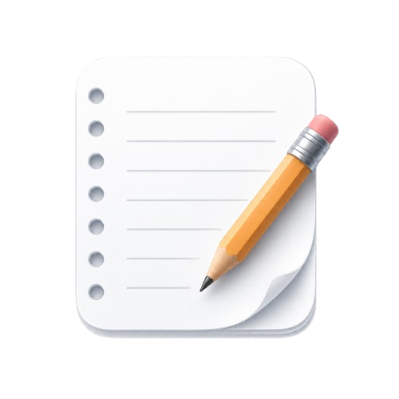
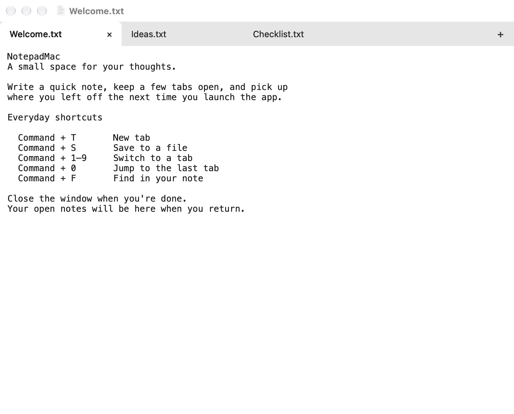
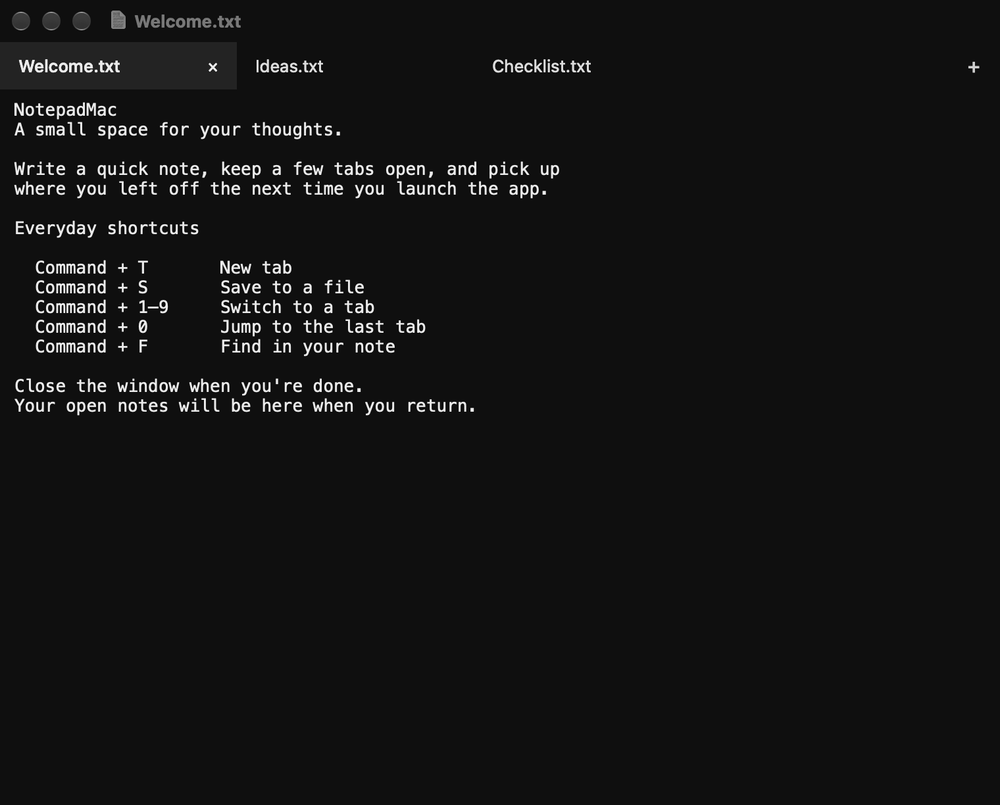

<h1 align="center">
  
  NotepadMac
</h1>

<p align="center">
  <strong>🪶 A minimalist Mac Notepad app that behaves like Sublime Text but looks better.</strong><br>
  Native Swift + AppKit. Just your notes, tabs, and a little peace of mind.<br>
  <em>Um bloco de notas minimalista para Mac, com a praticidade do Sublime Text e um visual mais bonito.</em>
</p>

<p align="center">
  <strong>📦 1.77 MB download · 💾 2.12 MB app · 🍎 Apple silicon + Intel · macOS 11+</strong>
</p>

<p align="center">
  <a href="https://github.com/Jhonatan-de-Souza/NotepadMac/releases/latest/download/NotepadMac-universal.zip"><strong>⬇️ Download for macOS / Baixar para macOS</strong></a><br>
  <a href="#english">🇺🇸 English</a> · <a href="#portugues">🇧🇷 Português</a> · <a href="https://github.com/Jhonatan-de-Souza/NotepadMac/releases/latest">📋 Release notes</a>
</p>

## 🧭 Contents / Índice

| English | Português |
| --- | --- |
| [⬇️ Get the app](#download) | [⬇️ Baixar o app](#baixar) |
| [✨ Features](#features) | [✨ Recursos](#recursos) |
| [📸 Screenshots](#screenshots) | [📸 Capturas de tela](#capturas) |
| [⌨️ Shortcuts](#shortcuts) | [⌨️ Atalhos](#atalhos) |
| [💾 Your notes](#notes) | [💾 Suas notas](#notas) |
| [🛠️ Build and development](#development) | [🛠️ Compilação e desenvolvimento](#desenvolvimento) |

<a id="english"></a>
## 🇺🇸 English

<a id="download"></a>
### ⬇️ Get the app

1. **[Download NotepadMac](https://github.com/Jhonatan-de-Souza/NotepadMac/releases/latest/download/NotepadMac-universal.zip)** — no build tools needed.
2. Unzip it and drag **NotepadMac.app** into **Applications**. To update, quit the old version first and replace it.
3. Press **Command+Space**, type **Notepad**, and open **NotepadMac**.

Runs on **Apple silicon and Intel Macs with macOS 11 or later**. The v1.1 release is **1.77 MB zipped** and **2.12 MB for the app bundle**. Those are measured file sizes, not RAM usage; your notes and filesystem allocation use additional disk space.

🔐 This release is ad-hoc signed, not Apple-notarized. If macOS blocks the first launch, and you trust this download, go to **System Settings → Privacy & Security → Open Anyway** after trying to open it. See [Apple's instructions](https://support.apple.com/en-us/102445). Older macOS versions use **System Preferences → Security & Privacy**.

<a id="features"></a>
### ✨ Small app, useful essentials

- 🪶 **Minimalist and lightweight:** native Swift + AppKit, without a bundled browser runtime.
- 🗂️ **Tabs that stay out of your way:** soft corners, light/dark themes, and a close button on hover. The selected tab always shows its close button and matches the editor background.
- 🔄 **Pick up where you left off:** closing the window or quitting preserves open notes, tab order, and the selected tab.
- 💾 **Save when you choose:** Command+S saves a new note wherever you want, or updates its existing file. Save As lets you choose another destination.
- 🔎 **The basics, done:** find, undo/redo, word wrap, and adjustable font size.

Closing an **empty tab** is immediate. Closing an **individual tab with unsaved text** asks whether to save or discard it and removes it from the session; closing the last tab leaves a fresh empty note. Closing the **window** keeps all open notes without asking you to save each one.

<a id="screenshots"></a>
### 📸 Light or dark, your choice

**☀️ Light**



**🌙 Dark**



*Sample notes only — no personal content in these screenshots.*

<a id="shortcuts"></a>
### ⌨️ Stay on the keyboard

| Shortcut | Action |
| --- | --- |
| Command+T / Command+N | New tab |
| Command+O | Open files |
| Command+S | Save the current note |
| Command+Shift+S | Save As |
| Command+W / Control+W | Close the current tab |
| Command+1–9 | Select tab 1–9 |
| Command+0 | Select the last tab, even with more than ten tabs |
| Command+F | Find in the current note |
| Command++ / Command+- | Increase / decrease font size |
| Command+Q | Quit and preserve the session |

<a id="notes"></a>
### 💾 Your notes stay on your Mac

Recovery data, including note text and file paths, lives at:

```text
~/Library/Application Support/NotepadMac/session.json
```

Recovery doesn't overwrite your saved files: use **Command+S** to write changes to them. Deleting the recovery folder removes the recoverable session, so include it in your backups if you rely on notes you haven't saved to files.

<a id="development"></a>
### 🛠️ Build and development

<details>
<summary>Build from source, run tests, or package a release</summary>

You'll need **macOS 11+** and **Xcode Command Line Tools**. Tests and screenshot scripts also require **Python 3**.

```sh
# Build, install in Applications, and refresh Spotlight indexing
./install.sh

# Build for the current Mac without installing
./build.sh
open build/NotepadMac.app

# Build and package for Apple silicon + Intel, with a SHA-256 checksum
./release.sh

# Run session and tab regression checks using isolated temporary notes
Tests/session-tests.sh

# Regenerate the README screenshots using sample notes
docs/capture-screenshots.sh
```

`./install.sh` asks a running installed copy to quit normally before updating. Run it again after changing the source to update your installed app. `./release.sh` creates `build/release/NotepadMac-universal.zip` and `SHA256SUMS.txt`; publishing is a separate step. The release is built for both architectures; runtime checks were performed on Apple silicon.

</details>

<a id="portugues"></a>
## 🇧🇷 Português

<a id="baixar"></a>
### ⬇️ Baixar o app

1. **[Baixe o NotepadMac](https://github.com/Jhonatan-de-Souza/NotepadMac/releases/latest/download/NotepadMac-universal.zip)** — não precisa compilar nada.
2. Descompacte o ZIP e arraste **NotepadMac.app** para **Aplicativos**. Para atualizar, encerre a versão anterior e substitua o app.
3. Pressione **Command+Espaço**, digite **Notepad** e abra **NotepadMac**.

Compatível com **Macs Apple silicon e Intel com macOS 11 ou posterior**. A versão v1.1 tem **1,77 MB para baixar** e **2,12 MB no pacote do app**. São tamanhos medidos dos arquivos, não consumo de RAM; suas notas e a alocação do sistema de arquivos ocupam espaço adicional.

🔐 Esta versão tem assinatura ad hoc, sem notarização da Apple. Se o macOS bloquear a primeira abertura e você confiar no download, vá a **Ajustes do Sistema → Privacidade e Segurança → Abrir Mesmo Assim** após tentar abrir o app. Consulte as [instruções da Apple](https://support.apple.com/pt-br/102445). Versões antigas do macOS usam **Preferências do Sistema → Segurança e Privacidade**.

<a id="recursos"></a>
### ✨ Pequeno no tamanho, com o essencial

- 🪶 **Minimalista e leve:** feito com Swift + AppKit, sem incluir um navegador no app.
- 🗂️ **Abas discretas:** cantos suaves, temas claro e escuro e botão de fechar ao passar o mouse. A aba selecionada sempre mostra o botão de fechar e tem a mesma cor do editor.
- 🔄 **Continue de onde parou:** ao fechar a janela ou sair, as notas abertas, a ordem das abas e a aba selecionada ficam preservadas.
- 💾 **Salve quando quiser:** Command+S permite escolher o destino de uma nota nova ou atualizar o arquivo existente. Use Save As para escolher outro local.
- 🔎 **O básico bem feito:** busca, desfazer/refazer, quebra de linha e ajuste do tamanho da fonte.

Fechar uma **aba vazia** é imediato. Ao fechar uma **aba individual com texto não salvo**, o app pergunta se você quer salvar ou descartar e remove a nota da sessão; ao fechar a última aba, uma nota vazia é criada. Fechar a **janela** preserva todas as notas abertas sem pedir para salvar cada uma.

<a id="capturas"></a>
### 📸 Claro ou escuro, você escolhe

Veja as capturas dos temas [☀️ claro](docs/screenshots/light.png) e [🌙 escuro](docs/screenshots/dark.png) na [galeria acima](#screenshots). Elas usam apenas notas de exemplo, sem conteúdo pessoal.

<a id="atalhos"></a>
### ⌨️ Tudo pelo teclado

| Atalho | Ação |
| --- | --- |
| Command+T / Command+N | Nova aba |
| Command+O | Abrir arquivos |
| Command+S | Salvar a nota atual |
| Command+Shift+S | Salvar como |
| Command+W / Control+W | Fechar a aba atual |
| Command+1–9 | Selecionar a aba de 1 a 9 |
| Command+0 | Selecionar a última aba, mesmo com mais de dez abas |
| Command+F | Buscar na nota atual |
| Command++ / Command+- | Aumentar / diminuir a fonte |
| Command+Q | Sair e preservar a sessão |

<a id="notas"></a>
### 💾 Suas notas ficam no seu Mac

Os dados de recuperação, incluindo o texto das notas e os caminhos dos arquivos, ficam em:

```text
~/Library/Application Support/NotepadMac/session.json
```

A recuperação não sobrescreve os arquivos salvos: use **Command+S** para gravar alterações neles. Excluir a pasta de recuperação apaga a sessão recuperável, então inclua essa pasta nos seus backups se você depende de notas ainda não salvas em arquivos.

<a id="desenvolvimento"></a>
### 🛠️ Compilação e desenvolvimento

<details>
<summary>Compilar, instalar, testar ou preparar uma versão</summary>

Requisitos: **macOS 11+** e **ferramentas de linha de comando do Xcode**. Os testes e scripts de captura também precisam de **Python 3**.

```sh
# Compilar, instalar em Aplicativos e atualizar a indexação do Spotlight
./install.sh

# Compilar para o Mac atual sem instalar
./build.sh
open build/NotepadMac.app

# Gerar um ZIP para Apple silicon + Intel, com checksum SHA-256
./release.sh

# Testar com notas temporárias separadas das suas
Tests/session-tests.sh

# Gerar as capturas do README com notas de exemplo
docs/capture-screenshots.sh
```

O `./install.sh` solicita o encerramento normal da cópia instalada antes de atualizar. Execute novamente após alterar o código. O `./release.sh` gera `build/release/NotepadMac-universal.zip` e `SHA256SUMS.txt`; a publicação é uma etapa separada. A versão é compilada para as duas arquiteturas; a execução foi verificada em Apple silicon.

</details>
