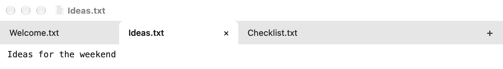
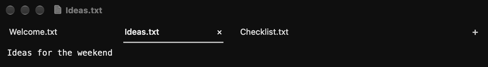
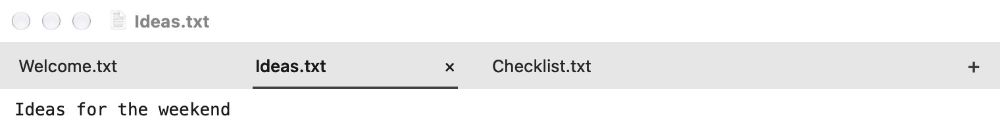
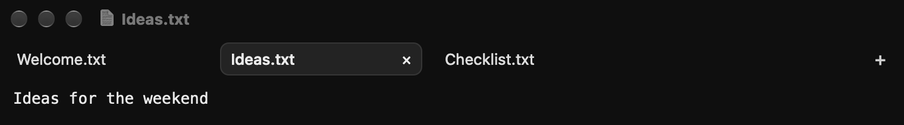
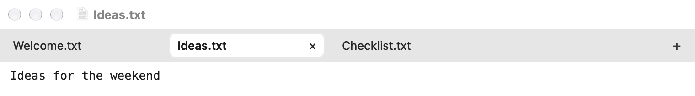
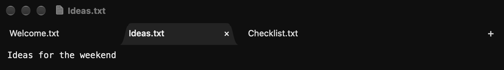
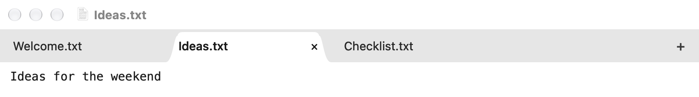

# Tab design options

Four previews rendered from the actual AppKit views with sample notes. The middle tab is selected to show both edges. The installed app and original light/dark palette are unchanged. All options retain the current close-button behavior: visible on the active tab, visible on hover for other tabs.

Regenerate from the project root with `docs/capture-tab-options.sh`.

## 1. Soft corners

Rounded upper corners with a straight bottom. A softer version of the current connected tabs.

Full windows: [dark](option-1-dark.png) · [light](option-1-light.png)

## 2. Underline

Minimal text labels and a thin underline marking the selected tab. The least visually busy option.

Full windows: [dark](option-2-dark.png) · [light](option-2-light.png)

## 3. Inset capsule

A softly rounded selection with a subtle outline and breathing room around it.

Full windows: [dark](option-3-dark.png) · [light](option-3-light.png)

## 4. Browser curve

Sloped sides that curve into the bottom of the tab bar, inspired by browser tabs.

Full windows: [dark](option-4-dark.png) · [light](option-4-light.png)
